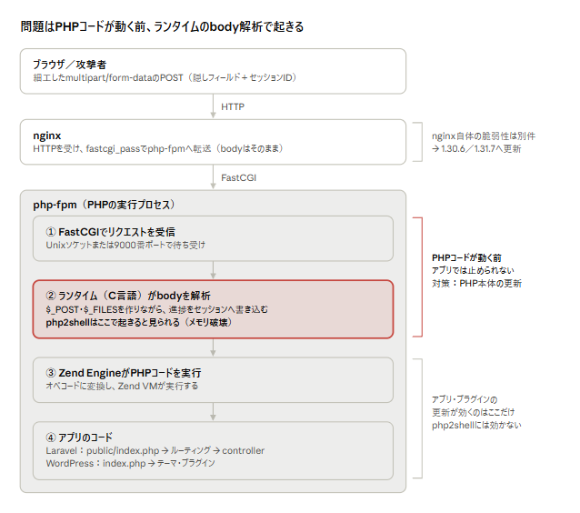

# PHPの脆弱性「php2shell」とnginx脆弱性の解説まとめ

Oct 21, 2026 · @masanori

## 概要

PHP本体に、外部から任意のコードを実行される重大な脆弱性が2件見つかり（通称php2shell）、修正版は2026年10月21日23時（日本時間）に公開予定です。アプリ（WordPressやLaravel）の更新では防げず、サーバー側のPHPを更新する必要があります。

- **PHP（php2shell）**：CVE-2026-109618とCVE-2026-109619。CVSS v4.0で9.2。情報が先に漏れ、修正版の公開が前倒しされました。
- **nginx**：2026年10月14日に複数の脆弱性が修正されています。1.30.6または1.31.7以降に更新します。
- **今すぐやること**：PHPを使うサーバーを洗い出し、23時の修正版をすぐ当てられるよう準備します。

## php2shell（CVE-2026-109618／109619）とは

PHPのコア（C言語で書かれたランタイム）にあるメモリ破壊系のバグで、細工したHTTPリクエストだけでサーバー上の任意コード実行（RCE）につながると見られています。

| 項目 | 内容 |
| --- | --- |
| CVE | CVE-2026-109618、CVE-2026-109619 |
| 深刻度 | CVSS v4.0で9.2（PHP公式）。出回った「10.0」は誤り |
| 種類 | リモートコード実行（watchTowrが確認）。メモリ破壊系と見られる |
| 原因（推測） | Session Upload Progress機能（ext/session）が関係（GMO Flatt Securityの調査） |
| 影響範囲 | PHP 5.4以降の広い範囲という報告。公式な範囲は修正版と同時に公表 |
| 修正版 | 2026年10月21日23時（日本時間）公開予定。サポート中の8.2以降のみ |
| 悪用状況 | 悪用できると主張するコードが出回り始めている。公開後すぐの大規模攻撃が予想されている |

### 経緯

1. 10月20日、本来はエンバーゴ（公表禁止期間）中だった情報がHacker Newsなどで漏れる
2. watchTowrが「本物」と確認
3. PHP公式が修正版の公開を10月21日14:00 UTC（日本時間23時）に前倒し

### 対策

- **根本対策**：PHPを修正版に更新する。php-fpmもPHPと一緒に配布されるので、パッケージ（例：`php8.x-fpm`）を更新して再起動する
- **緩和策**：`session.upload_progress.enabled = 0`。ただしFlattは「緩和にとどまり、攻撃は依然可能」と見ている
- **8.1以前**：公式の修正は出ない見込み。サポート中のバージョンへ移行するか、提供元にバックポートを依頼する

## リクエストの流れのどこで問題が起きるか



nginxはbodyを中身ごとphp-fpmへ渡すだけで、問題は②のC言語のランタイムで起きます。③④のPHPコードが1行も動く前なので、Laravel・WordPressやプラグインの更新では防げず、PHP本体の更新が必要です。

## session.upload\_progressとは

ファイルアップロードの進み具合をセッションに記録する、PHP 5.4から標準で入っている機能で、既定で有効です。外部ライブラリではなく、セッション拡張（`ext/session`）の一部です。

### 何をする機能か

大きなファイルをアップロードするときの進捗バー用です。今はブラウザのJavaScript（`upload.onprogress`など）だけで進捗がわかるので、ほぼ役目を終えていますが、互換性のために既定で有効のまま残っています。

1. 開発者がHTMLのフォームに、決まった名前の隠しフィールドを書く（ファイル選択欄より前）
2. ブラウザが送信すると、隠しフィールドもファイルも`multipart/form-data`のリクエストbodyに入る
3. PHP本体がbodyを解析しながら、受信済みバイト数などを`$_SESSION`に書き込み続ける
4. 別のリクエスト（AJAXなど）でセッションを読み、進捗を表示する

```html
<form action="upload.php" method="POST" enctype="multipart/form-data">
  <input type="hidden" name="PHP_SESSION_UPLOAD_PROGRESS" value="myupload">
  <input type="file" name="file">
  <input type="submit">
</form>
```

### なぜ危ないのか

隠しフィールドは**ただのPOSTパラメータ**です。サイトのフォームに無くても、外部の人がリクエストを自分で組み立てれば機能は動きます。動く条件は次の3つで、どれも送る側がそろえられます。

- `session.upload_progress.enabled`が有効（既定で有効）
- `multipart/form-data`のPOSTで、ファイルのパートより前にそのフィールドがある
- リクエストにセッションIDが付いている

### セッションの保存先

保存先は`session.save_handler`で決まります。

| save\_handler | 保存先 |
| --- | --- |
| `files`（既定） | サーバー上のファイル。`session.save_path`（例：`/var/lib/php/sessions`、`/tmp`）に`sess_<セッションID>`として作られる |
| `redis`／`memcached` | 拡張を入れればRedisやMemcached |
| 独自ハンドラ | PHPコードで書けばDBなど |

### 設定の確認と変更

- **php.iniはCLI用とphp-fpm用で別ファイル**のことが多い（Ubuntuなら`/etc/php/8.x/cli/php.ini`と`/etc/php/8.x/fpm/php.ini`）
- `php -i | grep upload_progress`はCLIの値しか見ない。php-fpmの実際の値は、fpm用のファイルを見るか、Web経由の`phpinfo()`で確認する（確認後は必ず削除）
- 無効化：fpm用のphp.iniに`session.upload_progress.enabled = 0`と書き、php-fpmを再起動する。プール設定で`php_admin_value[session.upload_progress.enabled] = 0`とする方法もある
- 無効にしてもほとんどのサイトは困らない。WordPress本体もこの機能には頼っていない

## WordPress・Laravelへの影響

影響を受けます。研究者の投稿では、mod\_phpやphp-fpm、WordPress・Laravel・Symfonyなどの構成で攻撃が再現したとされています。

- これはWordPressやLaravelの不具合ではなく、**それらを動かすPHPそのものの問題**です。本体やプラグイン、ライブラリを更新しても防げません。
- 問題の処理は、Laravelの`public/index.php`が1行も動く前に起きます。controllerやミドルウェアでは止められません。
- Laravelが独自のセッションの仕組みを使っていても、この記録はPHP標準のセッション機能を通して行われます。
- **自分でサーバーを管理している場合**：23時以降、PHPの修正版（またはOSのパッケージ更新）をすぐに適用します。
- **レンタルサーバー・マネージドWordPressの場合**：PHPの更新はホスティング会社の担当です。告知を確認し、使っているPHPが8.2以降かを管理画面で確かめます。
- 名前が似ている「WP2Shell」は、WordPress本体の脆弱性を指す別の件です。

## PHPのバージョンを上げるときの互換性

「PHPを上げるとWordPressやLaravelが動かなくなるのでは」という心配は、**どの桁を上げるか**で答えが変わります。

### php-fpmだけを上げることはできない

php-fpmはPHP本体と同じソース（php-src）から同時にビルドされる、PHPの入口（SAPI）の1つです。PHP 8.3.xのphp-fpmは、中身がPHP 8.3.xそのものです。そのため「php-fpmを上げる」と「PHPを上げる」は同じ意味で、片方だけを新しくすることはできません。OSパッケージなら`php8.x-fpm`を、コンテナなら`php:8.x-fpm`のベースイメージを更新します。

### パッチ版の更新（8.3.x → 8.3.y）は互換性の心配がほぼない

PHPのバージョンは`メジャー.マイナー.パッチ`です。パッチ版はバグ修正とセキュリティ修正だけで、言語仕様や関数は変わりません。php2shellの修正版は、サポート中の各系列（8.2／8.3／8.4…）にパッチ版として出ます。**8.2以降を使っているなら、WordPressやLaravel側の対応を待たずにすぐ当てられます。**

### マイナー版をまたぐ更新（8.1 → 8.2など）は互換性の問題が出る

マイナー版では、関数の削除や非推奨化などの仕様変更が入ります。アプリ側が新しいバージョンに対応していないと、エラーや警告が出たり、動かなくなったりします。

| 対象 | 状況 |
| --- | --- |
| WordPress本体 | 新しいPHPには「beta support」という扱いで段階的に対応する。本体は比較的早く追いつく |
| プラグイン・テーマ | **いちばん壊れやすい**。放置されたものは新しいPHPに対応しないまま残る |
| Laravel | `composer.json`の`"php": "^8.2"`のような制約と、依存パッケージの対応状況で決まる |

壊れる例：

- PHP 8.0で`create_function()`や`each()`が削除された
- PHP 8.2で動的プロパティ（宣言していないプロパティへの代入）が非推奨になり、警告が大量に出る

8.1以前を使っている場合は、「修正版が出ない」のに「上げると互換性の問題が出るおそれがある」という板挟みになります。上げる前にステージング環境で動作を確認し、問題のあるプラグインを更新するか、別のものに入れ替えます。

## php-fpm・FastCGI・PHPランタイムの仕組み

php-fpmは、FastCGIでリクエストを受け取り、C言語で書かれたPHPランタイムとZend Engineでコードを実行するプログラムで、問題の処理はそのランタイム部分にあります。

### php-fpmとFastCGI

- php-fpmはPHP 5.3.3から公式に同梱されている標準機能で、FastCGIというプロトコルで待ち受けます
- 待ち受け先はUnixソケット（例：`/run/php/php8.x-fpm.sock`）か、TCPポート（慣例的に9000番）です
- nginxが`fastcgi_pass`でリクエストを転送し、php-fpmが実行結果を返します
- 9000番ポートを外部に公開している環境は、それ自体が別の危険です

### PHPの入口（SAPI）

PHPにはWebサーバーとつなぐ入口が何種類かあり、どれも同じPHPコアを使います。そのため、どの入口でもphp2shellの影響を受けます。

| SAPI | 使われ方 |
| --- | --- |
| php-fpm | nginxなどと組み合わせる。今いちばん一般的 |
| mod\_php | Apacheに直接組み込む |
| CLI | コマンドラインで実行する |

### PHP本体はC言語製

- PHP本体（php-src）はC言語で書かれています。Zend Engine、リクエスト解析、セッション機能もすべてC言語です
- これをコンパイルした機械語が、`php-fpm`や`php`という実行ファイルです
- 関係するソースは`main/rfc1867.c`（アップロード解析）と`ext/session/session.c`（セッション）です
- 機械語なので仮想マシンは不要ですが、OS（Linux／Windows）とCPU（x86-64／ARM）ごとにビルドが必要で、glibcやOpenSSLなどの共有ライブラリにも依存します

### php-fpmの中の処理順

1. FastCGIでリクエストを受け取る（php-fpm）
2. ヘッダーとbodyを解析し、`$_GET`、`$_POST`、`$_FILES`、`$_COOKIE`を作る（C言語のランタイム）← **ここで進捗の記録が起きる**
3. PHPコードをオペコードに変換し、Zend VMが実行する（OPcacheで変換結果を再利用、PHP 8ではJITもあり）
4. 結果をFastCGIで返す

どんなPHPコードを書いても、2はそれより前に動きます。これが「アプリの修正では防げない」理由です。

## 背景知識：インタプリタ言語・コンパイル言語・Rust

PHPのコードは、C言語で作られたインタプリタへの入力データです。インタプリタのC言語部分にメモリのバグがあれば、PHPのコードをどれだけ安全に書いても防げません。

### インタプリタ言語とコンパイル言語

|  | コンパイル言語 | インタプリタ言語 |
| --- | --- | --- |
| 例 | C、C++、Go、Rust | PHP、Python、Ruby、Perl、Lua |
| 実行のしかた | 事前に機械語へ変換し、CPUが直接実行する | 実行時にインタプリタがコードを読んで処理する |
| 長所 | 速い。実行時にインタプリタが不要 | インタプリタがあればどこでも動く。すぐ試せる |
| 短所 | OS・CPUごとにコンパイルが必要 | 一般的に遅め |

厳密には言語ではなく処理系の違いで、境目はあいまいです。PHPやPythonも内部でバイトコードに変換しますし、JavaはJVM（C++製）でバイトコードを実行し、JavaScriptのV8（C++製）やPHP 8のJITは実行中に機械語へ変換します。CPython、CRubyもC言語製なので、同じ種類の脆弱性は他の言語でも起こりえます。

### C言語の弱点とRust

C言語はメモリを手作業で管理するため、次のようなバグが起きやすい言語です。php2shellも、10月のnginxの脆弱性も、この種類です。

- バッファオーバーフロー：確保した領域の外に書き込む
- Use-After-Free：解放したメモリを使い続ける
- 二重解放、未初期化メモリの読み取り

MicrosoftやGoogle（Chrome）は、深刻な脆弱性のおよそ7割がメモリ安全性の問題だと報告しています。Rustは、C言語並みの速さのままメモリ安全性を言語で保証できるため、Linuxカーネル、Android、Windows、Chromeで採用が進んでいます。

- **所有権と借用**：メモリの誤った使い方はコンパイルが通らない
- **範囲チェック**：配列の範囲外アクセスを防ぐ
- **GCが不要**：実行時のメモリ回収がなく、速さを犠牲にしない
- **限界**：`unsafe`部分はチェックが外れる。ロジックのバグは防げない。学習が難しめ。PHPのような巨大なCのコードの書き直しは現実的に大変

## nginxの脆弱性（2026年10月14日）

nginxはphp2shellとは別件で、10月14日にF5が11件（nginx本体5件、関連製品6件）を公表し、nginx 1.31.7（mainline）と1.30.6（stable）で修正済みです。10月21日時点で、これより新しい緊急の脆弱性は見つかっていません。

| CVE | 内容 | F5の評価 |
| --- | --- | --- |
| CVE-2026-15176 | rewriteやaliasの特定の設定で起きるヒープバッファオーバーフロー | CVSS v4.0 9.2 |
| CVE-2026-93479 | mapディレクティブと正規表現でのヒープバッファオーバーフロー | CVSS v4.0 9.2 |
| CVE-2026-97205 | 非同期I/OとSSIでのUse-After-Free | CVSS v4.0 9.2 |
| CVE-2026-95101 | HTTP/3でのリクエストbody注入 | CVSS 8.1 |
| CVE-2026-97629 | TLSチケット鍵ローテーションでのセッション偽造 | — |
| CVE-2026-94197、CVE-2026-104939 | Ingress Controllerの認証バイパス | CVSS 8.7 |

- 重大な3件は、認証なしの細工したHTTPリクエストでワーカープロセスをクラッシュさせられます。コード実行にはASLRの無効化または回避が必要です
- nginx公式は本体の5件を重要度「中」としていて、F5の「クリティカル」と評価が割れています（Security NEXTの指摘）
- 対応：1.30.6または1.31.7以降に更新。Ingress ControllerやNGINX Plusは、F5の勧告（K000163408）で修正版を確認します

## このリポジトリ（Laravel on ECS）での対応

このリポジトリは、Laravelをphp-fpmのコンテナ、nginxを別のコンテナとしてECS Fargateで動かしています。サーバーにパッケージを入れて更新するのではなく、**ベースイメージを更新してイメージを作り直し、タスクを入れ替える**のが「PHPを更新する」ことに当たります。Fargateのホスト（OS）はAWSが管理しているので、利用者側でやることはありません。

### 現状（2026年10月21日時点）

| 対象 | ファイル | ベースイメージ | 状態 |
| --- | --- | --- | --- |
| Laravel（本番：stg・preview） | [docker/ecr/backend/Dockerfile](../../../docker/ecr/backend/Dockerfile) | `php:8.2-fpm-bullseye` | **要対応**。このタグは2025年8月で更新が止まっている |
| Laravel（ローカル） | [docker/laravel/Dockerfile](../../../docker/laravel/Dockerfile) | `php:8.3-fpm` | 作り直せば修正版が入る |
| nginx（本番） | [docker/ecr/nginx/Dockerfile](../../../docker/ecr/nginx/Dockerfile) | `nginx:alpine` | 作り直せば最新版が入る |
| nginx（ローカル） | [docker/nginx/Dockerfile](../../../docker/nginx/Dockerfile) | `nginx:1.27-alpine` | 修正版（1.30.6以降）より古い。ローカル専用なので優先度は低い |

Docker Hubでは、`php:8.2-fpm-bullseye`（Debian 11）の最終更新日が2025-08-05です。一方、`8.2-fpm-bookworm`（Debian 12）は今も更新されています。Debian 13（`trixie`）が出た時期と重なるので、古いDebian向けのイメージが作られなくなったと考えられます。**今の`FROM`のまま作り直しても、php2shellの修正版は入りません。**

### 影響を受けるか

受けます。Laravelのセッションは`SESSION_DRIVER=database`ですが、これはLaravel独自の仕組みです。upload progressの記録は、Laravelより前にPHP本体の標準のセッション機能（既定では`files`）で行われます。どのセッションドライバーを使っていても関係ありません。

### やること

1. **ベースイメージのタグを変える**：`php:8.2-fpm-bullseye`を、更新が続いているタグ（`php:8.2-fpm-bookworm`など）に変える。Debianのバージョンが変わるので、`apt-get install`のパッケージ名や`imagick`のビルドが通るかを確認する
2. **緩和策を入れる**：[environment/ecr/php.ini](../../../environment/ecr/php.ini)に`session.upload_progress.enabled = 0`を足す（修正版が出るまでのつなぎ）
3. **23時以降、修正版が公式イメージに入ってから作り直す**：修正版が公開されてから、Docker公式イメージに反映されるまでには数時間かかることがある。`docker run --rm <image> php -v`でパッチ版の番号を確かめる
4. **イメージを作り直してデプロイする**：`ecr-deploy-laravel.yml`／`ecr-deploy-nginx.yml`でイメージをビルドしてECRに上げ、ECSのサービス（Web・キューのワーカー）を新しいイメージに入れ替える。preview環境も、PRへのpushで新しいイメージが使われる
5. **動作を確認する**：Laravelの画面と、画像アップロード（imagick・gd）が動くかを確認する

### あわせて考えたいこと

- **ローカル（8.3）と本番（8.2）で系列がずれている**：ローカルで動いても本番で動かない、またはその逆の原因になる。どちらかにそろえたい
- **PHP 8.2のセキュリティサポートは2026年12月31日まで**：あと2か月ほどで修正版が出なくなる。今回タグを変えるついでに、8.3以降への移行も検討する価値がある（ここはマイナー版をまたぐ更新になる）
- **タグを固定するか、追従させるか**：`php:8.2-fpm-bookworm`のような系列タグは、作り直すたびに最新のパッチ版が入る。一方で、いつ作ったかによって中身が変わる。`php:8.2.x-fpm-bookworm`のようにパッチ版まで固定すると再現性は上がるが、更新を自分で追う必要がある。今回は「止まったタグを使い続けていた」ことが問題だったので、どちらを選ぶにしても、ベースイメージを定期的に見直す仕組み（Dependabot、Renovateなど）があるとよい

## 対応チェックリスト

- [ ] PHPを使うサーバーをすべて洗い出す（バージョン、php-fpmかmod\_phpか、OSパッケージ・コンテナ・レンタルサーバーなど導入方法）
- [ ] 8.1以前のPHPがあれば、サポート中のバージョン（8.2以降）への移行を計画する
- [ ] php-fpm用のphp.iniで`session.upload_progress.enabled = 0`にし、php-fpmを再起動する（緩和策）
- [ ] 23時以降、PHPの修正版（OSパッケージ、Dockerベースイメージ）を適用し、php-fpmを再起動する
- [ ] 更新後にアプリの動作を確認する（E2Eテストなど）
- [ ] サーバー内のデータと権限（IAMロールなど）を最小限にする
- [ ] ログが記録・保全されているか確認する
- [ ] php-fpmの9000番ポートが外部に公開されていないか確認する
- [ ] nginxを1.30.6または1.31.7以降に更新する
- [ ] 確認用に置いた`phpinfo()`のページを削除する

## 出典

- [GMO Flatt Security Blog：php2shellの概要と対応指針](https://blog.flatt.tech/entry/php2shell)
- [Threat Landscape：PHP Core RCEs Leak Ahead of Embargo](https://threatlandscape.io/blog/php-core-rce-cve-2026-109618-109619-leak-ahead-of-embargo)
- [Sansec：PHP2Shell](https://sansec.io/research/php2shell)
- [Cyber Kendra：PHP RCE Zero-Days Leak Early](https://www.cyberkendra.com/2026/10/php-cve-2026-109618-cve-2026-109619-rce.html)
- [Security NEXT：nginxに複数脆弱性](https://www.security-next.com/191645)
- [F5 K000163408：Out-of-band Security Notification](https://my.f5.com/manage/s/article/K000163408)
- [Cyber Security News：Multiple NGINX Flaws](https://cybersecuritynews.com/multiple-nginx-vulnerabilities/)
- [H-ISAC Vulnerability Bulletin](https://www.aha.org/h-isac-white-reports/2026-10-19-h-isac-vulnerability-bulletin-tlp-white-f5-releases-out-band-security-updates-nginx-flaws)
